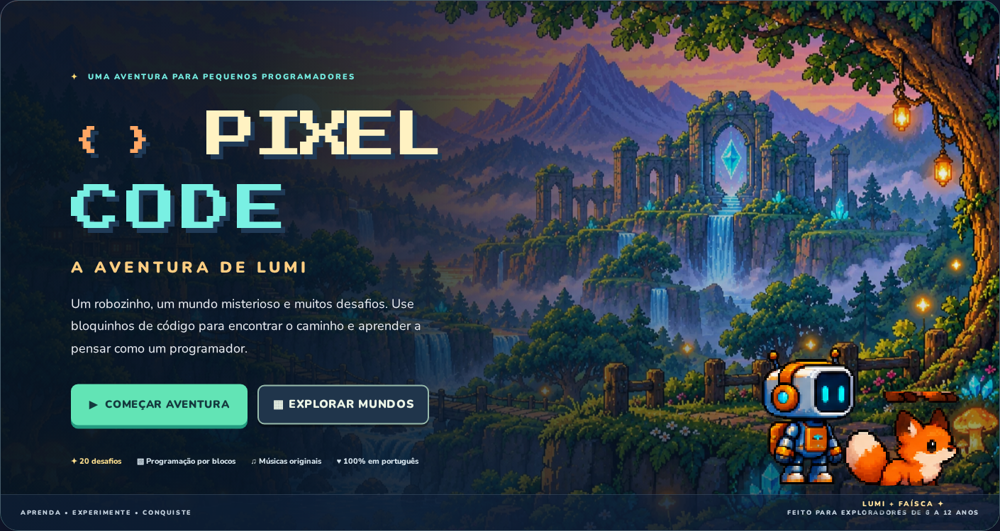
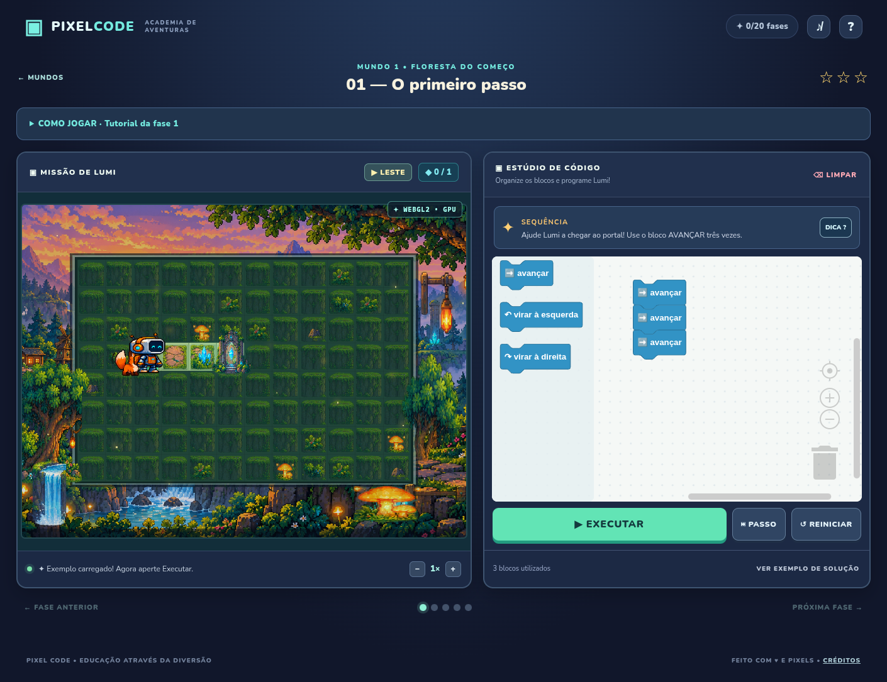
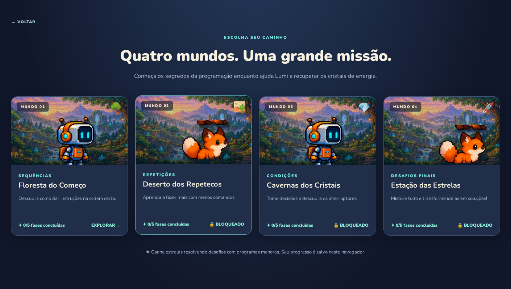
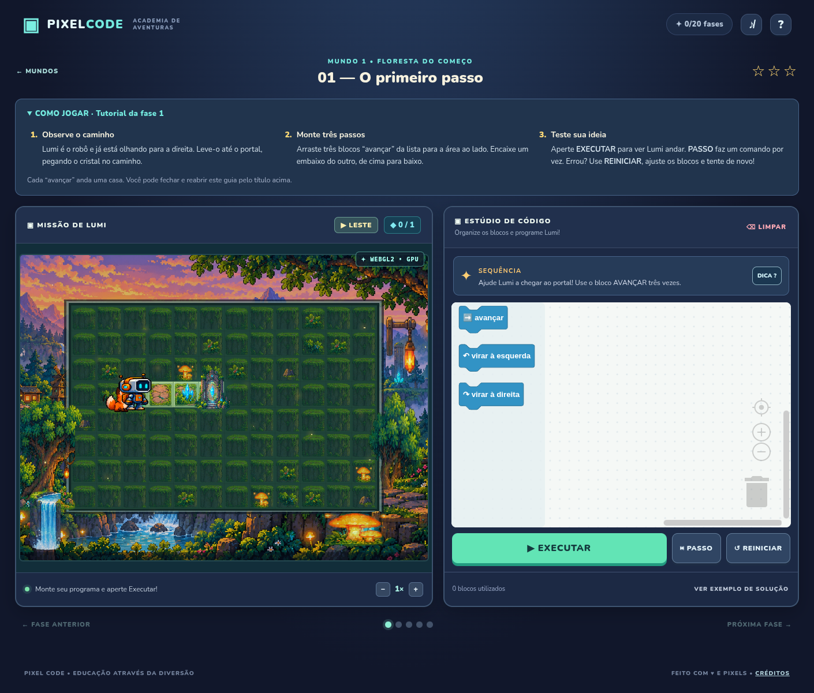
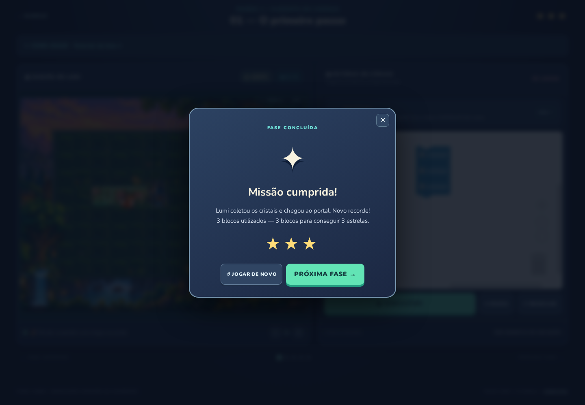

<div align="center">


# PIXEL CODE

### A Aventura de Lumi & Faísca

**Aprenda lógica de programação explorando um mundo em pixel art.**

Um robô, uma raposa e 20 desafios para transformar ideias em comandos.

[](https://github.com/pir0c0pter0/pixel-code-aventura/releases/tag/v0.2.0-alpha.1)   

[Começar a jogar](#começar-a-jogar) · [Como funciona](#como-jogar) · [Galeria](#galeria) · [Reportar um problema](https://github.com/pir0c0pter0/pixel-code-aventura/issues)



**Desenvolvido por [pir0c0pter0](https://github.com/pir0c0pter0)**
[pir0c0pter0000@gmail.com](mailto:pir0c0pter0000@gmail.com)

</div>

## Sobre o jogo

Pixel Code é um jogo educacional de navegador, em português, pensado para apresentar programação a crianças de **6 a 12 anos**. O jogador combina blocos de comandos para guiar **Lumi**, acompanhado da raposa **Faísca**, por caminhos com cristais, interruptores e portais.

Cada fase convida a observar, planejar, executar e corrigir. A dificuldade cresce de sequências simples até repetições, condições e algoritmos que combinam esses conceitos. Não é preciso digitar código para jogar.

> **Alpha · v0.2.0-alpha.1**
> Esta versão está disponível para testes e feedback. As 20 fases são jogáveis, mas a experiência e a compatibilidade entre dispositivos ainda estão em evolução.

## O que você encontra nesta alpha

| Recurso | Experiência |
| --- | --- |
| **20 fases em quatro mundos** | Desafios progressivos, com desbloqueio conforme a aventura avança. |
| **Programação visual** | Blocos para andar para cima, baixo, esquerda e direita, repetir e tomar decisões usando Blockly. |
| **Tutorial na primeira fase** | Três popups com instruções para observar o mapa, montar comandos e executar, com opções de avançar, voltar ou pular. |
| **Aprender testando** | Execução contínua, modo passo a passo, ajuste de velocidade, dicas e exemplos. |
| **Estrelas e progresso** | Soluções com menos blocos recebem mais estrelas; progresso e programas ficam no navegador. |
| **Pixel art animada** | Lumi e Faísca com animações, cenários, partículas e renderização WebGL2. |
| **Música e efeitos** | Trilhas por mundo, efeitos de ações e controle de áudio. |
| **Modo alternativo** | Canvas 2D quando WebGL2 não está disponível e editor de cliques se o Blockly não carregar. |

## Começar a jogar

O jogo é uma aplicação estática: **não precisa de instalação de pacotes, compilação, banco de dados ou servidor de API** para funcionar.

### Rodar no computador

Com Git e Python 3 instalados:

```bash
git clone https://github.com/pir0c0pter0/pixel-code-aventura.git
cd pixel-code-aventura
python3 -m http.server 8080 --bind 127.0.0.1
```

Abra **[http://localhost:8080](http://localhost:8080)** no navegador. Se a porta estiver ocupada, use `8081` no comando e no endereço. Para encerrar o servidor, pressione `Ctrl+C`.

Sem Git, baixe o código em **Code → Download ZIP** ou pela [pré-release alpha](https://github.com/pir0c0pter0/pixel-code-aventura/releases/tag/v0.2.0-alpha.1), extraia os arquivos e execute o mesmo comando dentro da pasta.

Também é possível abrir `index.html` diretamente. O servidor local é a opção recomendada para testar o projeto de forma consistente.

<details>
<summary><strong>Executar com Docker</strong></summary>

Com Docker e Docker Compose instalados, na raiz do projeto:

```bash
docker compose up -d --build
```

O Nginx serve o jogo em `http://localhost:8080`. Para encerrar:

```bash
docker compose down
```

</details>

### Conexão e armazenamento

- O editor de arrastar e encaixar carrega **Blockly 12.5.1** pelo CDN jsDelivr. Se o carregamento falhar, o jogo oferece um editor simplificado de cliques.
- Cenários, sprites, músicas e efeitos estão incluídos no projeto. As fontes Nunito e Press Start 2P vêm do Google Fonts, com fontes alternativas quando estiverem indisponíveis.
- O progresso e os programas ficam em `localStorage`, no navegador usado para jogar. Não há conta nem sincronização entre aparelhos; limpar os dados do site remove esses registros.
- **RECOMEÇAR AVENTURA**, no menu, pede confirmação para apagar as estrelas e os programas salvos e abrir a fase 1 com o tutorial.
- Para distribuir o editor Blockly integralmente offline, disponibilize uma cópia local da biblioteca, ajuste a referência em `index.html` e preserve os avisos da dependência descritos em [licenças e créditos](docs/LICENCAS.md).

## Como jogar

1. **Observe o mapa.** Identifique Lumi, os cristais e o portal de saída.
2. **Monte seu programa.** Arraste e conecte os blocos na ordem desejada. No editor simplificado, toque nos comandos para adicioná-los.
3. **Execute e acompanhe.** Use **EXECUTAR** para rodar o programa ou **PASSO** para avançar um comando por vez.
4. **Ajuste quando precisar.** **REINICIAR** reposiciona Lumi sem apagar os blocos; **LIMPAR** remove o programa da fase.
5. **Conclua a missão.** Colete os cristais e chegue ao portal. Tente resolver com menos blocos para conquistar três estrelas.

A primeira fase apresenta um tutorial que pode ser recolhido e reaberto. O botão **?** abre a ajuda geral; **DICA** oferece uma orientação específica para a missão. O exemplo de solução pede confirmação antes de substituir o programa atual.

## Quatro mundos para aprender

| Mundo | Fases | Conceitos |
| --- | :---: | --- |
| **Floresta do Começo** | 01–05 | Sequências, orientação e ordem dos comandos. |
| **Deserto dos Repetecos** | 06–10 | Laços de repetição e redução de instruções. |
| **Cavernas dos Cristais** | 11–15 | Condições, interruptores e portões. |
| **Estação das Estrelas** | 16–20 | Algoritmos, depuração e desafios combinados. |

Para atividades acompanhadas, o [guia do educador](docs/GUIA-EDUCADOR.md) traz uma proposta de cinco encontros, trabalho em duplas e perguntas para discutir as soluções.

## Galeria

**Uma missão em andamento — o mapa e o programa lado a lado.**



<table>
  <tr>
    <td width="50%" align="center"><strong>Os quatro mundos</strong></td>
    <td width="50%" align="center"><strong>Primeiros passos</strong></td>
  </tr>
  <tr>
    <td></td>
    <td></td>
  </tr>
</table>

<details>
<summary><strong>Ver a tela de missão cumprida</strong></summary>



</details>

<sub>Capturas reais da versão alpha, atualizadas após a revisão dos recortes de Lumi, Faísca e do cenário. Feitas no Chromium; a aparência pode variar conforme o navegador e o dispositivo.</sub>

## Por dentro do projeto

O jogo usa **HTML, CSS e JavaScript**, sem framework de aplicação. O Blockly fornece o editor visual; a lógica das missões e a execução dos comandos são próprias do projeto.

O programa do jogador é convertido em uma **árvore de comandos (AST)** e interpretado pelo motor, sem avaliar JavaScript arbitrário. A execução possui limites para interromper programas excessivamente longos e repetições sem saída.

A renderização principal usa **WebGL2**, com sprites agrupados em um atlas WebP de 2048 × 2048 pixels. Quando WebGL2 não está disponível, o jogo utiliza Canvas 2D. A trilha e os efeitos são reproduzidos pelas APIs de áudio do navegador após a interação do jogador.

```text
pixel-code-aventura/
├── index.html             # Telas, controles e carregamento dos scripts
├── style.css              # Interface, responsividade e animações do menu
├── game.js                # Fases, comandos, progresso e integração Blockly
├── gpu-renderer.js        # Renderizador WebGL2
├── assets/
│   ├── art/               # Atlas, sprites, cenários e arquivos-fonte
│   └── audio/             # Trilhas e efeitos
├── docs/
│   ├── GUIA-EDUCADOR.md   # Proposta de uso em atividades educativas
│   ├── LICENCAS.md        # Créditos e dependências externas
│   └── screenshots/      # Capturas utilizadas neste README
├── tests/                 # Verificações de currículo e interface
├── tools/build_atlas.py   # Geração do atlas e exportações de sprites
└── compose.yaml           # Serviço estático com Nginx
```

### Testes

**Currículo — requer Node.js, sem dependências npm:**

```bash
npm test
```

Verifica as rotas e executa uma solução vencedora para cada uma das 20 fases.

**Assets — requer Python 3 e Pillow:**

```bash
python3 tests/assets.py
```

Regenera os assets e verifica os 68 quadros dos personagens contra a arte original, detectando partes cortadas e fragmentos de vizinhos. Confere também os 100 itens do atlas, os metadados, os retratos e as faixas de animação do menu.

**Interface — requer Playwright, Chromium e o servidor local em execução:**

```bash
# Preparação opcional do ambiente de testes
npm install --no-save --package-lock=false playwright
npx playwright install chromium

# Com o servidor na porta 8080
GAME_URL=http://localhost:8080 node tests/ui.cjs
```

A suíte verifica sobreposições no menu, diálogos acima do editor, foco de teclado, telas pequenas, tutorial, conclusão da primeira fase, modo sem Blockly e cancelamento de avisos de vitória após sair da fase. Os cenários com Blockly precisam de acesso ao CDN; o cenário alternativo bloqueia esse acesso de propósito.

As soluções das **20 fases** e os cenários de interface foram verificados no Chromium durante a preparação desta alpha. Isso não equivale a uma validação em todos os celulares, navegadores ou GPUs.

<details>
<summary><strong>Regenerar o atlas de sprites</strong></summary>

Com Python 3 e Pillow disponíveis:

```bash
python3 -m pip install pillow
python3 tools/build_atlas.py
```

O script usa as folhas em `assets/art/source/` e exporta o atlas, metadados, retratos e faixas de animação usados pelo jogo.

</details>

## Estado da alpha

Esta versão prioriza a aventura local e os fundamentos de programação. Ainda não há login de alunos, painel de professor, progresso na nuvem, editor de fases ou avaliação pedagógica formal. Compatibilidade com dispositivos móveis e diferentes GPUs continua sendo uma área de testes.

Para reportar um problema, [abra uma issue](https://github.com/pir0c0pter0/pixel-code-aventura/issues) com a fase, o navegador, o dispositivo, os passos para reproduzir e, se possível, um print. Sugestões de clareza nas instruções e dificuldade das missões também são bem-vindas.

## Desenvolvimento e créditos

**Desenvolvedor:** [pir0c0pter0](https://github.com/pir0c0pter0)
**Contato:** [pir0c0pter0000@gmail.com](mailto:pir0c0pter0000@gmail.com)

O editor visual utiliza **Blockly**, sob Apache-2.0. Os detalhes sobre arte, áudio, fontes e outras referências estão em [licenças e créditos](docs/LICENCAS.md).

O projeto está publicado para apresentação e testes da alpha. A licença do código permanece **`UNLICENSED`**, conforme `package.json`; esta publicação não altera os termos das dependências de terceiros.
